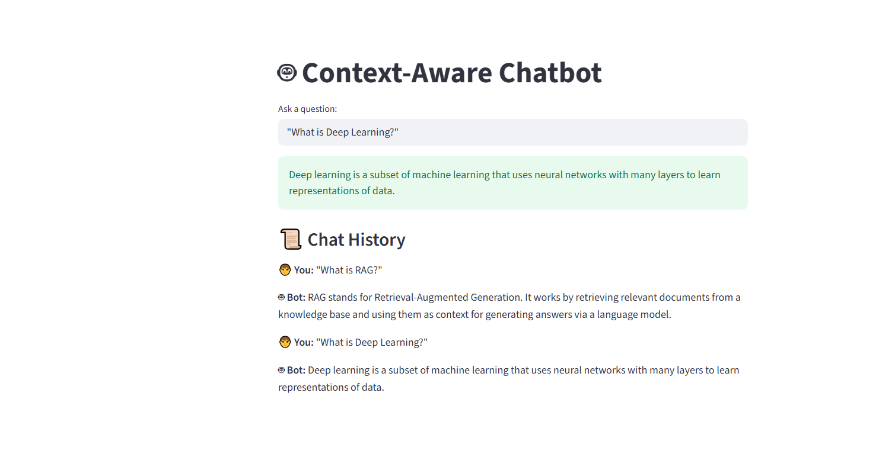

# Context-Aware Chatbot

## Objective
The goal of this project is to build a **context-aware chatbot** capable of retrieving relevant information from a custom knowledge base and providing accurate responses. The chatbot leverages **Retrieval-Augmented Generation (RAG)** to answer user queries while maintaining conversational context across multiple interactions. This system allows users to interact naturally and access information from various domains such as mathematics, physics, and AI topics.

## Methodology / Approach
The project follows a **retrieval-based conversational approach**:

1. **Data Preparation**
   - A custom corpus (`data.txt`) containing information from multiple domains (e.g., math, physics, AI concepts) is used.
   - Text is split into chunks using LangChain’s `CharacterTextSplitter`.

2. **Embeddings Generation**
   - Each text chunk is converted into vector embeddings using **GoogleGenerativeAIEmbeddings**.
   - These embeddings allow semantic similarity searches.

3. **Vector Store**
   - Chroma is used as a vector database to store embeddings for fast retrieval.

4. **Conversational Chain**
   - A **ConversationalRetrievalChain** integrates:
     - Chat model (`ChatGoogleGenerativeAI`) for response generation.
     - Retrieval from Chroma vector store.
     - Conversation memory (`ConversationBufferMemory`) to maintain context across queries.

5. **Frontend**
   - Streamlit provides a simple UI for users to input queries.
   - Chat history is displayed for reference.
   - Delay simulation is added to mimic “thinking” time.

## Key Results / Observations
- The chatbot **successfully retrieves relevant information** from the custom corpus and generates accurate answers.
- **Contextual awareness** is achieved using conversation memory, allowing multi-turn interactions where previous questions affect the answers.
- The system can answer questions across multiple domains including:
  - Mathematics (e.g., derivatives, integrals)
  - Physics (e.g., Newton’s laws, speed of light)
  - AI/ML (e.g., deep learning, activation functions, RAG workflow)
- The integration of embeddings and vector search ensures **high relevance of retrieved information**.
- Streamlit UI with chat history provides a user-friendly interface for interacting with the chatbot.

## Result Output


## Future Improvements
- Add support for **larger knowledge bases** and document uploads.
- Implement **real-time typing effect** for responses.
- Introduce **fine-grained control** over the retrieval mechanism for domain-specific queries.
- Extend the chatbot to **handle multiple languages**.

## Usage
1. Install dependencies:
   ```bash
   pip install -r requirements.txt


## Project Architecture

```text
┌────────────────────────────┐
│      User Input (Query)    │
└─────────────┬──────────────┘
              │
              ▼
┌────────────────────────────┐
│ Streamlit UI (Frontend)    │
│ - Text input box           │
│ - Chat history display     │
└─────────────┬──────────────┘
              │
              ▼
┌────────────────────────────┐
│  Retrieval Chain / QA      │
│  ConversationalRetrievalChain
│  - Uses chat memory        │
└─────────────┬──────────────┘
              │
              ▼
┌────────────────────────────┐
│  Retriever (Vector Search) │
│ - Chroma vector store      │
│ - Finds relevant chunks    │
│   from data.txt            │
└─────────────┬──────────────┘
              │
              ▼
┌────────────────────────────┐
│ Embeddings Generator       │
│ - GoogleGenerativeAIEmbeddings
│ - Converts text chunks to vectors
└─────────────┬──────────────┘
              │
              ▼
┌────────────────────────────┐
│  LLM (ChatGoogleGenerativeAI)
│ - Uses retrieved context + query
│ - Generates response
└─────────────┬──────────────┘
              │
              ▼
┌────────────────────────────┐
│ Streamlit UI Output        │
│ - Displays answer          │
│ - Updates chat history     │
└────────────────────────────┘
